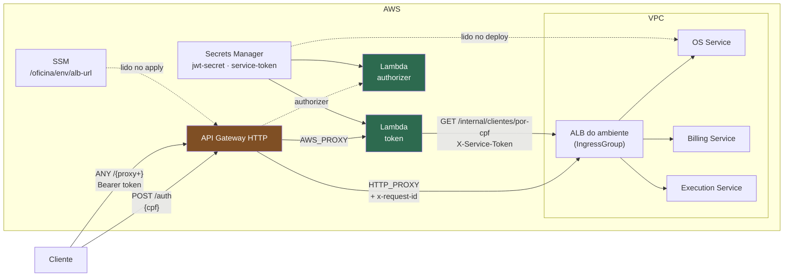

# oficina-lambda-auth — Function Serverless de autenticação + API Gateway

Camada de **entrada e autenticação** do Tech Challenge SOAT 13 — Fases 3 e 4.
Provisiona o **API Gateway HTTP** que é o endereço público do sistema e as duas
funções **AWS Lambda** que emitem e validam o token de acesso.

> ### Estado: completo (Fase 4)
> Emissão de token, consulta do cliente e authorizer estão implementados, com
> **34 testes** cobrindo o fluxo inteiro. O authorizer está **ligado**
> (`enable_authorizer = true`): as rotas proxy exigem `Bearer` válido.
>
> **Fase 4:** a função `token` deixou de ler o banco do OS Service. Ela consulta o cliente por HTTP
> (`GET /internal/clientes/por-cpf/{cpf}`, [ADR 0002](docs/adr/0002-consulta-de-cliente-pelo-os-service.md)),
> saiu da VPC e o gateway passou a apontar para o **ALB** que serve os três serviços, lido do SSM.
> Código **nunca aplicado** na AWS: foi validado por testes e por `terraform validate`.

## Lugar na arquitetura



**Pré-requisito:** os três serviços implantados naquele ambiente. O deploy de cada um grava o
endereço do ALB em `/oficina/<env>/alb-url` (SSM) e o `infra/` do OS cria os segredos
`oficina/<env>/service-token` e `oficina/<env>/jwt-secret`; o `plan`/`apply` daqui lê os três
(`infra/ssm.tf` e `infra/secrets.tf`). Este repositório não lê o state de nenhum outro.

## Rotas

| Rota | Integração | Autenticação |
|---|---|---|
| `POST /auth` | Lambda `token` | Pública — é onde o token é obtido |
| `POST /webhooks/mercadopago` | ALB → Billing | **Pública, sem authorizer** — o Mercado Pago não tem JWT; a assinatura `x-signature` é conferida pelo Billing ([ADR 0007](https://github.com/soat13-oficina/oficina-app/blob/desenvolvimento/docs/adr/0007-mercado-pago-checkout-pro.md)) |
| `ANY /{proxy+}` | ALB → OS, Billing ou Execution, por caminho | Lambda Authorizer (quando `enable_authorizer = true`) |

O ALB é um só por ambiente e roteia por caminho (ADR 0008); o gateway tem uma integração só. O
`/internal/**` **não** é roteado pelo gateway: a Lambda `token` chega ao OS direto no ALB, onde só
`/internal/clientes/*` com o header `X-Service-Token` é encaminhado.

### Contrato de `POST /auth`

```jsonc
// requisição
{ "cpf": "529.982.247-25" }

// 200
{
  "token": "eyJhbGciOiJIUzI1NiIs...",
  "expiraEm": 3600,
  "tipo": "Bearer",
  "cliente": { "id": "3f1c9a2e-...", "nome": "Fulano de Tal" }
}

// 400 CPF_INVALIDO · 404 CLIENTE_NAO_ENCONTRADO · 403 CLIENTE_INATIVO · 500 ERRO_INTERNO
{ "codigo": "CPF_INVALIDO", "mensagem": "CPF invalido." }
```

Toda resposta carrega o header `x-request-id`, o mesmo id que aparece no log
estruturado e no access log do gateway.

## Componentes

| Arquivo | O que faz | Testes |
|---|---|---|
| `src/lib/cpf.mjs` | Validação por dígito verificador, normalização e máscara para log | 6 |
| `src/lib/jwt.mjs` | Assina HS256 e verifica HS256/384/512 com `node:crypto`; comparação em tempo constante e recusa de `alg` inesperado | 8 |
| `src/lib/cliente-api.mjs` | Consulta o cliente no OS Service (`GET /internal/clientes/por-cpf/{cpf}`, `X-Service-Token`, timeout de 3 s); 404 vira "não existe", qualquer outra falha vira erro | 11 |
| `src/lib/segredos.mjs` | Lê o Secrets Manager com cache no container | — |
| `src/lib/log.mjs` | Log JSON com `requestId` de correlação | — |
| `src/handlers/token.mjs` | Fluxo completo de `POST /auth` | 8 |
| `src/handlers/authorizer.mjs` | Valida o Bearer e devolve `isAuthorized` + contexto | — |
| `infra/` | Terraform: gateway, 2 Lambdas, IAM, leitura do ALB (SSM), do `jwt-secret` e do `service-token`, log groups | — |

```bash
npm test     # 34 testes, sem framework externo (node:test)
```

## Contrato com o OS Service e com a aplicação

Três acoplamentos que quebram o login se mudarem sem coordenação:

**1 · `GET /internal/clientes/por-cpf/{cpf}` no OS** — contrato em
[`docs/contratos/rest-interno.md`](https://github.com/soat13-oficina/oficina-app/blob/desenvolvimento/docs/contratos/rest-interno.md)
do `oficina-app`. Resposta `200 {id, nome, ativo}`; `404` se não existe; `401` se o `X-Service-Token`
está errado. O inativo **volta** (`ativo: false`) e quem recusa com `403 CLIENTE_INATIVO` é esta função.

**2 · O segredo `oficina/<env>/service-token`** — criado pelo `infra/` do OS, lido por nome
(`SERVICE_TOKEN_ARN`). Sem ele o `plan` falha com mensagem clara.

**3 · A claim `tipo: "CLIENTE"`** — é por ela que o `JwtAuthenticationFilter` da
aplicação decide autenticar pelas próprias claims em vez de procurar o CPF na
tabela `usuarios`. Um cliente não é usuário do sistema e não deve precisar ser.

Sobre algoritmos: assinamos em **HS256** e verificamos **HS256, HS384 e HS512**.
A assimetria é proposital — a `jjwt` da aplicação escolhe o algoritmo pelo
*tamanho* da chave e, com o segredo de 64 caracteres gerado pelo Terraform,
assina em HS512. Um authorizer restrito a HS256 recusaria no gateway todo token
vindo do login de e-mail e senha.

## Tecnologias

Node.js 22 (ESM, `fetch` nativo, zero dependência além do AWS SDK) · `node:test` · AWS Lambda ·
API Gateway HTTP (v2) · AWS Secrets Manager · SSM Parameter Store · CloudWatch Logs · Terraform ≥ 1.10
com workspaces · GitHub Actions.

## Como rodar e implantar

```bash
npm ci
npm test
npm run build          # monta build/ com src + node_modules de produção

cd infra
cp backend.hcl.example backend.hcl              # bucket do state
cp terraform.tfvars.example terraform.tfvars    # mesma bucket
terraform init -backend-config=backend.hcl
terraform workspace select -or-create hml       # ou prd
terraform apply
```

⚠️ **`npm run build` antes de qualquer `terraform plan/apply`.** O
`archive_file` empacota `build/`; sem ele o plan falha com *no such file or
directory*. A pipeline já faz isso.

Ordem: `oficina-infra-k8s` → `oficina-infra-database` → `infra/` do OS, do Billing e da Execution →
deploy dos três serviços (o ALB nasce no primeiro `Ingress` e cada pipeline grava o endereço no SSM) →
**este repositório**. Não há mais `app_base_url` para preencher à mão.

## CI/CD

Workflow: [`.github/workflows/ci-cd.yml`](.github/workflows/ci-cd.yml)

| Gatilho | O que roda |
|---|---|
| Pull request | `npm test` → `fmt` → `validate` → `plan` dos dois workspaces, comentado no PR |
| Push em `desenvolvimento` | Testes + plan dos dois workspaces |
| **Push em `homologacao`** | Testes → build → **`apply` no workspace `hml`** → smoke test de `POST /auth` |
| **Push em `master`** | Testes → build → **`apply` no workspace `prd`** → smoke test |
| *Run workflow* manual | `plan`, `apply` ou `destroy` no ambiente escolhido |

Jobs, no padrão de nomes comum aos quatro repositórios do projeto:

| Job | O que faz |
|---|---|
| `testes` | `npm test` — 34 casos com `node:test`, sem framework externo |
| `validacao` | `terraform fmt -check` e `terraform validate` |
| `plan` | `terraform plan` do workspace, comentado no PR |
| `deploy` | `npm run build` → `terraform apply` no workspace do ambiente → smoke test |
| `destroy` | `terraform destroy` no workspace do ambiente |

O smoke test faz um `POST /auth` real depois do apply e falha o job se o gateway
não responder — pega rota mal configurada ou `lambda_permission` faltando, que
são os erros silenciosos mais comuns aqui.

### Workflow auxiliar — `Formatar Terraform`

[`terraform-fmt.yml`](.github/workflows/terraform-fmt.yml), manual (*Run
workflow*): roda `terraform fmt -recursive`, regrava o `infra/.terraform.lock.hcl`
com os hashes de Linux, macOS e Windows e commita o resultado **na branch em que
foi disparado** — escolha a sua branch de trabalho, não `master` nem
`homologacao` (protegidas, o push seria recusado).

Existe porque o gate `fmt -check` reprova qualquer desalinhamento e nem todo
mundo do time tem o Terraform instalado na máquina. Enquanto o lockfile não
estiver versionado, cada `terraform init` resolve as versões de provider do zero
dentro das restrições de `infra/versions.tf`; rode este workflow uma vez na sua
branch para fixá-las.

### Configuração exigida no repositório

| Tipo | Nome | Valor |
|---|---|---|
| Secret | `AWS_ACCESS_KEY_ID` | Credencial AWS da pipeline |
| Secret | `AWS_SECRET_ACCESS_KEY` | — |
| Variable | `TF_STATE_BUCKET` | **A mesma bucket** das outras camadas |
| Variable | `AWS_REGION` | Opcional, default `us-east-1` |

### Regras de proteção de branch

`master` e `homologacao` protegidas, merge só por Pull Request, fluxo
`feature/*` → `desenvolvimento` → `homologacao` → `master` imposto pelo job
`guard` ([`pr-source-guard.yml`](.github/workflows/pr-source-guard.yml)).

## Contrato do segredo JWT com o repositório da aplicação

O segredo HMAC fica em `oficina/<ambiente>/jwt-secret` no Secrets Manager. Desde a
Fase 4 ele é criado pelo `infra/` do OS Service (`oficina-app`), como o
`service-token`, e lido **por nome** aqui (`infra/secrets.tf`) e pelas pipelines
dos três serviços, que populam `JWT_SECRET` no cluster.

Motivo da mudança: o deploy do Billing e da Execution exige o segredo, e este
repositório exige o ALB que esses deploys criam. Com o segredo aqui, a subida do
ambiente tinha um ciclo; com ele no `infra/` do OS, a ordem é linear
(`infra/` dos serviços → deploy dos serviços → esta Lambda).

> Um `destroy` do `infra/` do OS gera um segredo novo no próximo `apply`, o que
> invalida todos os tokens em circulação. Um `destroy` daqui não mexe nele.

## Custo estimado

Lambda e API Gateway são pagos por uso e ficam **dentro do *free tier*** no
volume de uma demonstração (1 M de requisições/mês grátis na Lambda; US$ 1,00 por
milhão no HTTP API). O custo relevante desta camada é praticamente zero — o que
pesa é a plataforma (EKS/NAT) e o banco.

## Limitações conhecidas (escopo de desafio técnico)

- **HS256 com segredo compartilhado.** RS256 + JWKS seria a evolução correta; a justificativa está no ADR.
- **O ALB segue público**, então é possível contornar o gateway: cada serviço valida o JWT por conta própria, e o `/internal/clientes` exige o `X-Service-Token` (o ALB só confere que o header veio; o OS confere o valor). A alternativa — ALB interno + VPC Link — está registrada como evolução no ADR 0008 do `oficina-app`.
- **O login depende do OS Service no ar.** Antes lia o banco direto. A evolução (OS publica `ClienteCadastrado/Atualizado`, uma Lambda mantém uma tabela DynamoDB de CPFs) está descrita no plano da Fase 4.
- **CORS liberado para `*`.** Adequado à demo; um front real fixaria a origem.

## API — Swagger, contrato e collection

O gateway provisionado aqui é o **endereço público de todo o sistema**, então a
documentação da API da aplicação é consumida através dele.

| O quê | Onde |
|---|---|
| **Swagger UI** | `<api_gateway_url>/swagger-ui/index.html` |
| **Contrato OpenAPI** | `<api_gateway_url>/v3/api-docs` |
| **Collection do Insomnia** | [`oficina-app/docs/collections/oficina-api.insomnia.json`](https://github.com/soat13-oficina/oficina-app/blob/master/docs/collections/oficina-api.insomnia.json) — gerada a partir do OpenAPI |

Ao importar a collection, aponte a variável `base_url` para o
**`api_gateway_url`** deste repositório, e não para o ALB: é assim que as
chamadas passam pelo authorizer e o fluxo fica igual ao de produção.

O `POST /auth` **não está no OpenAPI da aplicação** — ele é servido pela Lambda,
não pelo Spring. O contrato dele está em
[Contrato de `POST /auth`](#contrato-de-post-auth), e é a primeira chamada de
qualquer sessão: ela devolve o `token` que as demais usam no header
`Authorization`.

```bash
# 1. obtenha o token
curl -s -X POST "$API_GATEWAY_URL/auth" \
  -H 'content-type: application/json' \
  -d '{"cpf":"529.982.247-25"}'

# 2. use nas rotas protegidas
curl -s "$API_GATEWAY_URL/clientes" -H "Authorization: Bearer $TOKEN"
```

## Documentação

- [ADR 0001 — API Gateway HTTP, Lambda Authorizer e JWT HS256](docs/adr/0001-api-gateway-e-autorizacao.md)
- [RFC 0003 — Estratégia de autenticação](https://github.com/soat13-oficina/oficina-app/blob/master/docs/rfc/0003-estrategia-de-autenticacao.md)
- [Diagramas de sequência — autenticação por CPF e rota protegida](https://github.com/soat13-oficina/oficina-app/blob/master/docs/arquitetura/diagramas-sequencia.md)
- ADRs de infraestrutura: repositórios `oficina-infra-k8s` e `oficina-infra-database`
